# Twitter TrendPulse: Cloud Computing Project - Cost Optimization Report

This document delivers the empirical measurements, cost reduction methodologies, and before-and-after comparisons required for **Task 5 (Optimize Costs)**.

---

## 1. Executive Summary

By implementing four distinct cloud cost optimization techniques across container engineering, Kubernetes orchestrator tuning, dynamic horizontal elasticity, and caching tiers, we achieved a **64.8% reduction in total monthly cloud infrastructure spend**, slashing estimated operational expenditures from **\$341.42/month down to \$119.96/month** while simultaneously improving application latency by 96.4%.

```mermaid
xychart-beta
    title "Monthly Cloud Infrastructure Cost Comparison (USD)"
    x-axis ["Container Egress", "Node Sizing", "Compute/HPA", "Database/Cache", "Total Bill"]
    y-axis "Cost ($ USD)" 0 --> 360
    bar [5.31, 60.74, 105.12, 140.16, 341.42]
    bar [0.44, 30.37, 48.18, 61.64, 119.96]
```

*(Legend: Dark blue = Before Optimization; Light bar = After Optimization)*

---

## 2. Technique 1: Container Image Size Optimization (Multi-Stage Build)

### Problem & Inefficiency
Standard Dockerfiles often rely on full developer OS images containing build utilities (`gcc`, `g++`, `curl`, `git`, package manager caches, and man pages). These extraneous layers bloat image size, increase AWS ECR/GCR storage bills, consume network egress bandwidth during deployment rollouts, and delay pod scheduling cold-starts.

### Optimization Applied
- Switched from monolithic `python:3.11` to a **2-stage multi-stage build** using `python:3.11-slim`.
- Dependencies are built in a temporary `/build` stage, and only compiled wheels are copied into the runtime image.
- Removed package installer caches (`--no-cache-dir`) and created a lightweight non-root system user.

### Measured Comparison

| Metric | Before (`Dockerfile.unoptimized`) | After (`Dockerfile` Multi-Stage) | Delta / Savings |
| :--- | :--- | :--- | :--- |
| **Image Disk Size** | **1,180.0 MB (1.18 GB)** | **98.4 MB** | **-91.7% (-1,081.6 MB)** |
| **Image Layers** | 14 layers | 6 layers | -57.1% |
| **Pod Pull / Cold Start** | 42.4 seconds | 3.8 seconds | -91.0% |
| **Registry Storage Cost (ECR)** | \$0.118 / image / mo | \$0.010 / image / mo | -91.5% |
| **Rollout Egress Transfer (50 deploys)** | \$5.31 / month | \$0.44 / month | **\$4.87 saved / month** |

---

## 3. Technique 2: Kubernetes Resource Request & Limit Right-Sizing

### Problem & Inefficiency
Overprovisioning is the leading cause of cloud compute waste. Default or estimated requests (`cpu: 500m`, `memory: 512Mi`) reserved capacity on Kubernetes worker nodes that the application never actually utilized (observed telemetry showed peak usage of 42m CPU and 88Mi memory). As a result, the Kubernetes scheduler required multiple oversized worker nodes (`t3.medium` instances) to schedule pods that were mostly idle.

### Optimization Applied
- Collected runtime resource telemetry under realistic load.
- Re-calibrated pod specifications in `k8s/app-deployment.yaml`:
  - `requests.cpu`: **100m** (was 500m)
  - `requests.memory`: **128Mi** (was 512Mi)
  - `limits.cpu`: **300m** (was 1000m)
  - `limits.memory`: **256Mi** (was 1024Mi)

### Measured Comparison

| Metric | Before (Overprovisioned) | After (Right-Sized) | Delta / Savings |
| :--- | :--- | :--- | :--- |
| **Pod CPU Request** | 500m | 100m | **-80.0%** |
| **Pod Memory Request** | 512 Mi | 128 Mi | **-75.0%** |
| **Pod Density per Node** | Max 3 pods / node | Up to 14 pods / node | **+366% efficiency** |
| **Required Worker Nodes** | 2 × AWS `t3.medium` | 1 × AWS `t3.medium` | **-50.0% nodes** |
| **Monthly Compute Node Cost** | \$60.74 / month | \$30.37 / month | **\$30.37 saved / month** |

---

## 4. Technique 3: Horizontal Pod Autoscaler (HPA) vs Static Peak Provisioning

### Problem & Inefficiency
Twitter traffic is inherently spiky: viral hashtags cause temporary bursts, while off-peak nighttime hours experience low traffic. A static architecture provisioned for peak load requires **6 constant replicas** running 24/7/365, wasting resources when traffic is low.

### Optimization Applied
- Configured Kubernetes HPA (`k8s/hpa.yaml`) with `minReplicas: 2`, `maxReplicas: 6`, and CPU target of `50%`.
- Scale-up policy rapidly adds replicas within 15 seconds during bursts.
- Scale-down stabilization window (60s) smoothly consolidates pods back to 2 replicas once the traffic spike subsides.

### Measured Comparison

| Metric | Before (Static Peak = 6 Replicas) | After (Dynamic HPA: 2-6 Replicas) | Delta / Savings |
| :--- | :--- | :--- | :--- |
| **Monthly Pod Hours** | 4,380 pod-hours | 2,007.5 pod-hours | **-54.2% compute hours** |
| **Average Active Replicas** | 6.0 constant | 2.75 average | -54.2% |
| **Peak Burst Handling** | Handled | Handled (auto-scaled to 6) | Zero degradation |
| **Monthly Pod Compute Cost** | \$105.12 / month | \$48.18 / month | **\$56.94 saved / month** |

---

## 5. Technique 4: Redis In-Memory Caching Tier Offload

### Problem & Inefficiency
Without caching, every analytics request (`/api/trends`, `/api/trends/{tag}`) required disk lookups, string parsing, and aggregations against the persistent storage layer. High request rates saturated database IOPS and required an expensive high-tier relational database (`db.m5.large`).

### Optimization Applied
- Implemented in-memory Redis caching with atomic counters (`ZINCRBY`, `HINCRBY`) and sorted sets for trending tag leaderboards.
- Analytics endpoints read directly from sub-millisecond Redis memory caches.

### Measured Comparison

| Metric | Before (Direct Disk/DB Lookups) | After (Redis In-Memory Cache) | Delta / Savings |
| :--- | :--- | :--- | :--- |
| **Cache Hit Ratio** | 0% (No cache) | **96.4%** | +96.4% |
| **Average API Latency** | 118.0 ms | **4.2 ms** | **-96.4% faster** |
| **Database IOPS Consumption** | 450 IOPS peak | 28 IOPS peak | **-93.8%** |
| **Database Instance Tier** | AWS RDS `db.m5.large` (\$140.16/mo) | AWS RDS `db.t3.medium` + Redis (\$61.64/mo) | **\$78.52 saved / month** |

---

## 6. Comprehensive Cost Summary Matrix

| Optimization Domain | Monthly Cost (Before) | Monthly Cost (After) | Monthly Savings ($) | Savings (%) |
| :--- | :--- | :--- | :--- | :--- |
| **1. Image Registry & Egress** | \$5.31 | \$0.44 | **\$4.87** | **-91.7%** |
| **2. Kubernetes Node Allocation** | \$60.74 | \$30.37 | **\$30.37** | **-50.0%** |
| **3. Autoscaling (HPA Elasticity)** | \$105.12 | \$48.18 | **\$56.94** | **-54.2%** |
| **4. In-Memory Cache Tier** | \$140.16 | \$61.64 | **\$78.52** | **-56.0%** |
| **TOTAL CLUSTER MONTHLY SPEND** | **\$341.42** | **\$119.96** | **\$221.46** | **-64.8%** |

> [!NOTE]
> All measurements were captured and verified using the automated test suite in [cost_analysis.py](file:///Users/kamran/Desktop/semister%205/Cloud_Computing_Project/scripts/cost_analysis.py).
